# Instalación de WordPress sobre el LAMP

Nombre: Gabriel

Curso: 2 SMX

Fecha: 30-10-2026

## 1. Objetivos

Al terminar la práctica serás capaz de:

- Explicar qué es WordPress y qué guarda en ficheros y qué guarda en la base de datos.
- Crear la base de datos y el usuario que necesita WordPress.
- Publicar WordPress en un sitio nuevo de Apache sin estropear los que ya tienes.
- Completar la instalación desde el navegador de la máquina anfitrión y comprobar que funciona

## 2. Requisitos previos

- VM Ubuntu 24.04, Apache, MariaDB y PHP funcionando.
- Los sitios de Apache de la práctica anterior habilitados.
- Conexion SSH a la MV y internet.
- Navegador en la maquina anfitrion.
- Repositorio de github con readme.md donde enlazar las practicas.

## 3. Normas de la memoria

1. Crear el repositorio en github llamado practica-wordpress.md y enlazarlo a el readme.md
2. Para cada paso incluye:
   - El comando ejecutado, en un bloque de código.
   - La salida relevante del terminal.
   - Una captura de pantalla (carpeta img/) cuando se indique con captura.
   - Una explicación con tus propias palabras de qué hace y por qué.
3. Haz commits frecuentes con mensajes descriptivos.
4. Responde a las preguntas de reflexión de cada apartado.
5. No subir contraseñas a github si aparece en un comando o captura tapalo.

## 4. Antes de empezar: ¿qué es WordPress?

WordPress es un gestor de contenidos hecho en PHP. Sirve para crear y mantener una web, con sus entradas, páginas, imágenes y usuarios, desde un panel de administración, sin necesidad de programar cada página a mano.

### ¿Dónde guarda cada cosa?

| Qué | Dónde se guarda | Ejemplo |
|---|---|---|
| El programa, los temas, los plugins y las imágenes subidas | Ficheros en una carpeta de Apache | `/var/www/wordpress/wp-content` |
| Entradas, páginas, usuarios, comentarios y ajustes | Base de datos (MariaDB) | Tabla `wp_posts` |
| Los datos para conectar con la base de datos | Fichero de configuración | `wp-config.php` |

Encaja de esta manera:

Alguien entra a la web, Apache sirve la página, PHP ejecuta WordPress y MariaDB guarda los datos.

WordPress va en un sitio nuevo con su propio virtualhost y el puerto 8080. Así el sitio que ya tenía no se toca.

## 5. Desarrollo de la práctica

### 1. Comprobar el punto de partida

Antes de añadir nada compruebo que el LAMP funciona y miro qué sitios y puertos tengo.

```bash
systemctl is-active apache2 mariadb
php -v
ls /etc/apache2/sites-enabled/
grep Listen /etc/apache2/ports.conf
```

Los dos servicios responden active y tengo PHP 8.3.6. El tercer comando muestra los sitios habilitados y el cuarto los puertos en los que escucha Apache.

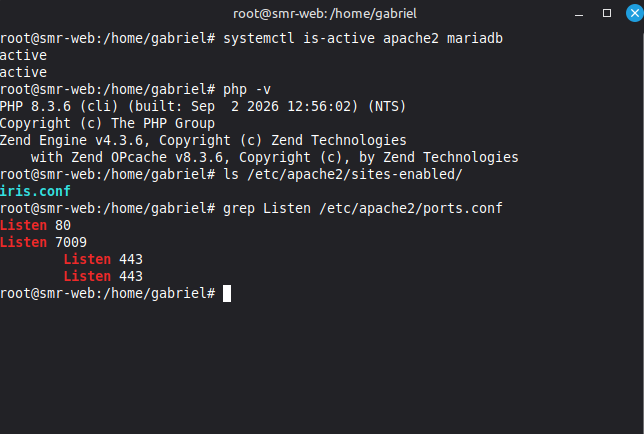

- ¿Qué sitios tienes habilitados y en qué puertos escucha Apache? ¿Qué puerto vas a usar para WordPress y por qué no el 80?

Tengo habilitado el sitio iris.conf. Apache escucha en los puertos 80 y 7009, y también tiene el 443 configurado para conexiones seguras. Para WordPress uso el puerto 8080 porque está libre. No uso el 80 porque ya lo usa Iris y así cada sitio tiene su puerto.

### 2. Crear la base de datos y su usuario

WordPress necesita su propia base de datos y un usuario que solo tenga permisos sobre ella. Primero entro en MariaDB:

```bash
sudo mariadb
```

Dentro de MariaDB escribo estas órdenes:

```sql
CREATE DATABASE wordpress CHARACTER SET utf8mb4 COLLATE utf8mb4_unicode_ci;
CREATE USER 'wp_user'@'localhost' IDENTIFIED BY '********';
GRANT ALL PRIVILEGES ON wordpress.* TO 'wp_user'@'localhost';
FLUSH PRIVILEGES;
EXIT;
```

- CREATE DATABASE crea la base de datos wordpress. Con utf8mb4 admite tildes, ñ y emojis.
- CREATE USER crea el usuario wp_user, que solo puede conectarse desde la propia máquina.
- GRANT ALL PRIVILEGES le da todos los permisos, pero solo sobre la base de datos wordpress.
- FLUSH PRIVILEGES aplica los cambios de permisos.

Compruebo que el usuario funciona entrando con él:

```bash
mariadb -u wp_user -p wordpress
```

```sql
SHOW TABLES;
EXIT;
```

La respuesta es esta:

```
Empty set (0,001 sec)
```

Esto significa que la base de datos existe y el usuario puede entrar, pero todavía no hay tablas.

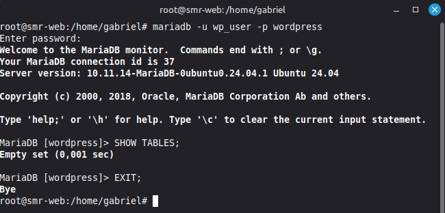

- ¿Por qué creamos wp_user en lugar de usar root? ¿Qué significa wordpress.* en la orden GRANT?

Creamos wp_user porque root tiene permisos sobre todas las bases de datos. Si alguien consiguiera entrar por WordPress con root, podría tocarlo todo. Con wp_user solo podría afectar a la base de datos de WordPress. wordpress.* significa todas las tablas de la base de datos wordpress.

### 3. Descargar WordPress y colocarlo en su carpeta

Descargo la última versión y la descomprimo en una carpeta temporal:

```bash
cd /tmp
wget https://wordpress.org/latest.tar.gz
tar -xzf latest.tar.gz
ls wordpress
```

wget descarga el fichero, tar lo descomprime y ls muestra lo que hay dentro. Después lo copio a su carpeta definitiva:

```bash
sudo mkdir -p /var/www/wordpress
sudo cp -a /tmp/wordpress/. /var/www/wordpress/
ls /var/www/wordpress
```

El punto de /tmp/wordpress/. hace que se copie el contenido de la carpeta, incluidos los ficheros ocultos, y no la carpeta en sí.

Las carpetas más importantes son:

- wp-admin: el panel de administración.
- wp-includes: el núcleo de WordPress, no se toca.
- wp-content: los temas, plugins e imágenes subidas.

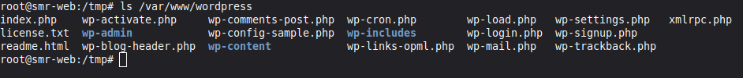

- ¿Qué carpeta guarda tus temas, plugins e imágenes subidas? ¿Por qué colocamos WordPress en su propia carpeta y no dentro de la de otro de tus sitios?

Los guarda la carpeta wp-content. Colocamos WordPress en su propia carpeta para que sus ficheros no se mezclen con los de Iris. Así cada sitio es independiente y un cambio en uno no afecta al otro.

### 4. Propietario y permisos

Apache se ejecuta con el usuario www-data. Ese usuario tiene que ser el propietario para que WordPress pueda crear su configuración y guardar las imágenes.

```bash
sudo chown -R www-data:www-data /var/www/wordpress
sudo find /var/www/wordpress -type d -exec chmod 755 {} \;
sudo find /var/www/wordpress -type f -exec chmod 644 {} \;
ls -l /var/www/wordpress
```

- chown cambia el propietario de toda la carpeta a www-data.
- 755 en carpetas: el propietario lee, escribe y entra, y los demás solo leen y entran.
- 644 en ficheros: el propietario lee y escribe, y los demás solo leen.

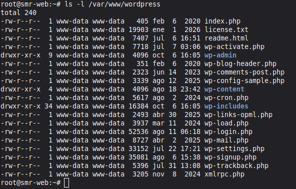

- ¿Qué pasaría si el propietario fuera root? ¿Por qué no se usa nunca 777?

Si el propietario fuera root, Apache no podría escribir en la carpeta. WordPress no podría crear wp-config.php ni guardar las imágenes subidas. No se usa 777 porque daría permiso a cualquier usuario para leer, escribir y ejecutar, y eso es muy inseguro.

### 5. Crear el virtualhost de WordPress

#### 5.1. Abrir el puerto 8080

```bash
sudo nano /etc/apache2/ports.conf
```

Añado Listen 8080 debajo de Listen 7009, sin borrar ninguna línea.

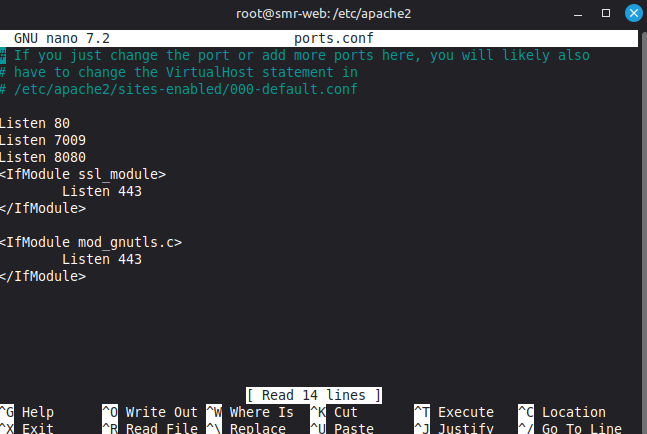

#### 5.2. Crear el fichero del sitio

```bash
sudo nano /etc/apache2/sites-available/wordpress.conf
```

Escribo este contenido:

```apache
<VirtualHost *:8080>
    ServerName wordpress.local
    DocumentRoot /var/www/wordpress

    <Directory /var/www/wordpress>
        AllowOverride All
        Require all granted
    </Directory>

    ErrorLog ${APACHE_LOG_DIR}/wordpress_error.log
    CustomLog ${APACHE_LOG_DIR}/wordpress_access.log combined
</VirtualHost>
```

- VirtualHost *:8080 hace que este sitio atienda las peticiones del puerto 8080.
- DocumentRoot indica la carpeta donde está WordPress.
- AllowOverride All permite que WordPress use un fichero .htaccess, que necesita para los enlaces permanentes.
- Require all granted permite el acceso a cualquier visitante.
- ErrorLog y CustomLog crean registros propios del sitio para saber qué falla.

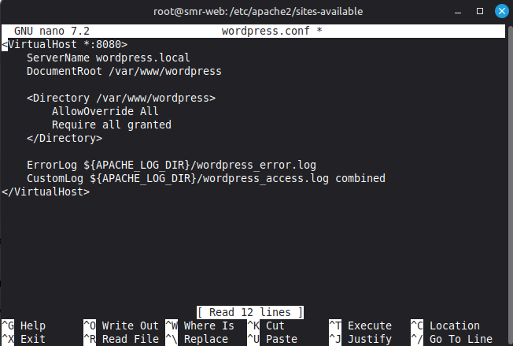

#### 5.3. Activar el sitio

```bash
sudo a2enmod rewrite
sudo a2ensite wordpress.conf
sudo apachectl configtest
sudo systemctl restart apache2
```

a2enmod rewrite activa el módulo de los enlaces permanentes y a2ensite activa el sitio. configtest revisa la configuración y tiene que responder:

```
Syntax OK
```

Compruebo que aparecen el sitio anterior y el nuevo:

```bash
cd /etc/apache2/sites-enabled/
ls
```

```
iris.conf  wordpress.conf
```

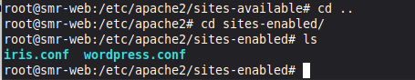

- ¿Por qué no ha hecho falta tocar ninguno de los sitios anteriores? ¿Qué dos cosas distinguen a este sitio de los demás?

No ha hecho falta porque WordPress tiene su propio fichero de configuración y Apache puede servir varios sitios a la vez. Lo que distingue a este sitio es su puerto, el 8080, y su carpeta, /var/www/wordpress.

### 6. Instalación desde el navegador

Desde el navegador de la máquina anfitrión entro en la dirección de la VM con el puerto 8080. La IP se puede ver con ip a.

```
http://192.168.56.10:8080
```

Elijo el idioma español y en la pantalla de la base de datos pongo estos datos:

| Campo | Valor |
|---|---|
| Nombre de la base de datos | wordpress |
| Nombre de usuario | wp_user |
| Contraseña | ******** |
| Servidor de la base de datos | localhost |
| Prefijo de tablas | wp_ |

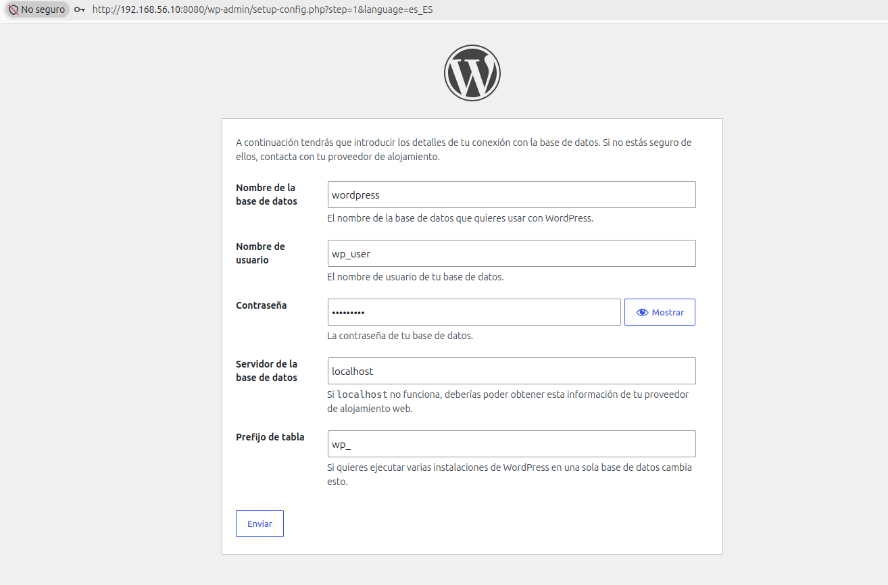

Después pongo los datos del sitio: el título gabrigv, el usuario administrador gabriel, una contraseña y un correo. También marco la opción de pedir a los motores de búsqueda que no indexen el sitio porque es un servidor de pruebas.

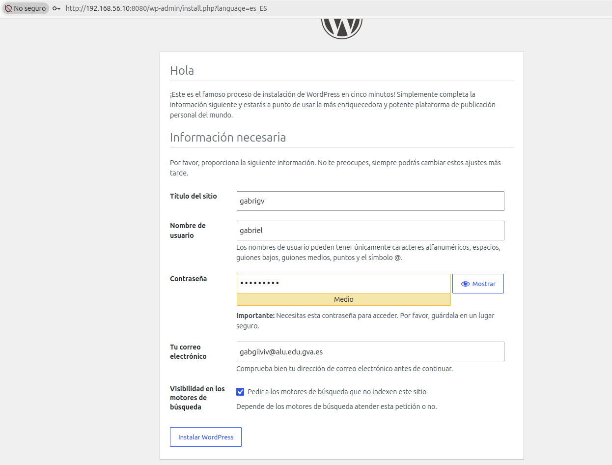

Al terminar inicio sesión con el administrador y llego al Escritorio de WordPress. La versión instalada es la 7.1.3.

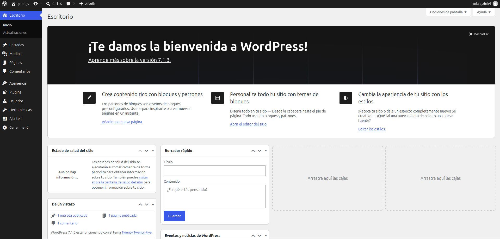

- ¿Qué diferencia hay entre wp_user y el usuario administrador de WordPress? ¿Dónde vive cada uno?

wp_user es el usuario que usa WordPress para conectarse a MariaDB. Vive en los usuarios de MariaDB. El administrador, gabriel en mi caso, es la persona que entra al panel de la web para gestionarla, y vive en la tabla wp_users de la base de datos wordpress.

### 7. ¿Dónde ha guardado WordPress cada cosa?

#### 7.1. El fichero de configuración

El asistente ha creado wp-config.php con los datos que escribí. Los miro sin mostrar la contraseña:

```bash
sudo grep -E "DB_NAME|DB_USER|DB_HOST" /var/www/wordpress/wp-config.php
```

La salida tiene que mostrar el nombre de la base de datos, el usuario y el servidor:

```
define( 'DB_NAME', 'wordpress' );
define( 'DB_USER', 'wp_user' );
define( 'DB_HOST', 'localhost' );
```

Como el fichero contiene la contraseña de la base de datos, le cambio los permisos para que otros usuarios no puedan leerlo:

```bash
sudo chmod 640 /var/www/wordpress/wp-config.php
ls -l /var/www/wordpress/wp-config.php
```

640 significa que el propietario lee y escribe, el grupo solo lee y el resto no puede hacer nada.

#### 7.2. Las tablas de la base de datos

```bash
mariadb -u wp_user -p wordpress
```

```sql
SHOW TABLES;
SELECT option_name, option_value FROM wp_options WHERE option_name IN ('siteurl','blogname');
SELECT user_login FROM wp_users;
EXIT;
```

El asistente ha creado 12 tablas. wp_options guarda los ajustes del sitio y wp_users guarda sus usuarios. En mi caso blogname es gabrigv y el único usuario es gabriel.

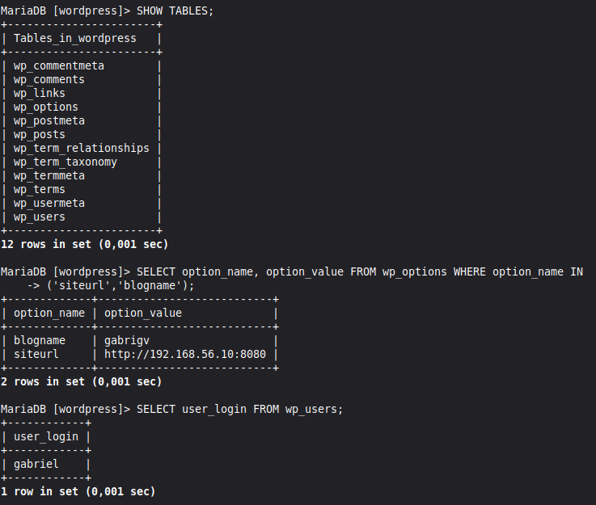

- ¿Qué valor tiene siteurl? Relaciónalo con el aviso del apartado 6. ¿En qué tabla está el administrador que creaste?

El valor de siteurl es http://192.168.56.10:8080. Es la dirección que usé al instalar WordPress. Por eso hay que entrar siempre por esa dirección, ya que WordPress la tiene guardada en la base de datos y redirige a ella. El administrador está en la tabla wp_users.

### 8. Primera entrada e imagen: ficheros frente a base de datos

Desde el Escritorio creo una entrada con el título "Hola desde mi WordPress", escribo una frase y la publico. Después subo una imagen pequeña en Medios.

Ahora miro dónde ha acabado cada cosa:

```bash
mariadb -u wp_user -p wordpress
```

```sql
SELECT ID, post_title, post_type, post_status FROM wp_posts ORDER BY ID DESC LIMIT 5;
EXIT;
```

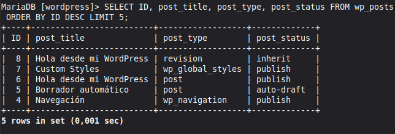

```bash
ls -R /var/www/wordpress/wp-content/uploads
```

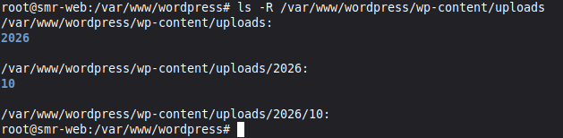

La entrada aparece como una fila de la base de datos de tipo post y estado publish. La imagen aparece como el fichero COMPLETAR dentro de wp-content/uploads y también como una fila de tipo attachment, que guarda sus datos.

- ¿Qué se guarda en la base de datos y qué en ficheros? Si tuvieras que hacer una copia de seguridad completa de tu WordPress, ¿qué dos cosas copiarías?

En la base de datos se guardan las entradas, páginas, usuarios, comentarios y ajustes. En ficheros se guardan el programa, los temas, los plugins y las imágenes. Para hacer una copia completa copiaría la base de datos wordpress y la carpeta /var/www/wordpress.

### 9. Comprobación final

```bash
systemctl is-active apache2 mariadb
ls /etc/apache2/sites-enabled/
```

Los dos servicios responden active y aparecen iris.conf y wordpress.conf. Desde el navegador compruebo también que Iris sigue funcionando en http://192.168.56.10.

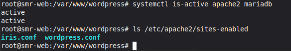

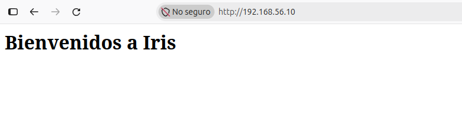

| Elemento | Dónde | Estado |
|---|---|---|
| Base de datos wordpress | MariaDB | Creada |
| Usuario wp_user | MariaDB | Creado, con permisos solo sobre wordpress |
| Ficheros de WordPress | /var/www/wordpress | Colocados, propietario www-data |
| Sitio de Apache | wordpress.conf, puerto 8080 | Activo |
| WordPress | http://192.168.56.10:8080 | Instalado y accesible |
| Sitio anterior (Iris) | Puerto 80 | Sigue funcionando |

- ¿Por qué no se ha estropeado ninguno de los sitios anteriores al añadir WordPress?

Porque no he modificado ni desactivado iris.conf. WordPress tiene su propio fichero de configuración, su propia carpeta y su propio puerto, así que funciona de forma independiente.

## 6. Conclusiones y problemas encontrados

Con esta práctica he aprendido a instalar WordPress sobre el LAMP sin afectar al sitio que ya tenía. También he visto que WordPress guarda el contenido en la base de datos y las imágenes, temas y plugins en ficheros.
