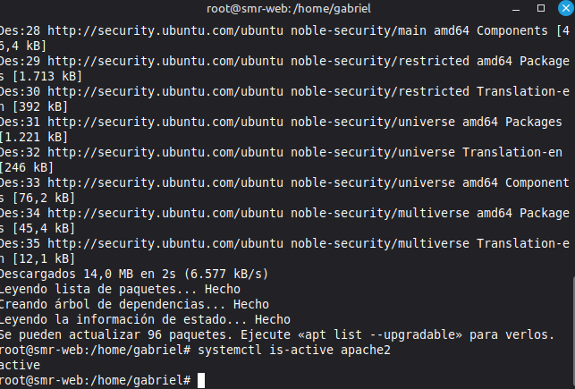
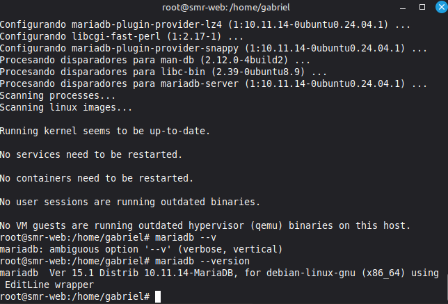
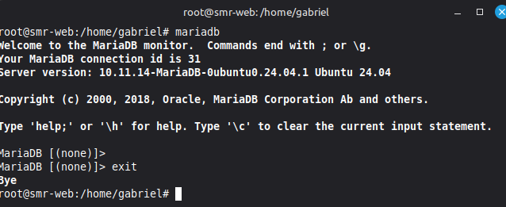

# Instalación de MariaDB en Ubuntu 24.04

## 1. Objetivos

Al terminar la práctica serás capaz de:
• Explicar qué es una base de datos y para qué la necesita WordPress.
• Instalar MariaDB sobre Ubuntu 24.04 y comprobar que funciona.
• Instalar PHP y comprobar que Apache lo ejecuta.
• Dejar el servidor (Linux, Apache, MariaDB y PHP) listo para instalar WordPress

## 2. Requisitos previos

- VM Ubuntu 24.04 y apache funcionando.
- Permisos sudo en la VM y conexion a internet.
- Repositorio de github con readme.md donde enlazar las practicas

## 3. Normas de la memoria

1. Crear el repositorio en github llamado practica-mariadb.md y enlazarlo a el readme.md
2. Para cada paso hay que poner:
   - El comando ejecutado.
   - La salida del comando en la terminal.
   - Captura de pantalla cuando lo indique
   - Explicacion de tus propias palabras de las preguntas y que hace.
3. En github hacer commits con mensajes precisos.
4. Responder a las pregutas en el documento

## 4. Antes de empezar: ¿qué es una base de datos?

Una base de datos es como un archivador donde un programa guarda su información. Una base de datos esta organizada en tablas como en una hoja de calculo, con columnas y filas.

### ¿Para qué necesitamos WordPress?

WordPress guarda en la base de datos todo lo que no son ficheros: las entradas, paginas, comentarios, usuarios y configuracion del sitio. Cada vez que alguien visita la web WordPress le pide los datos a la base de datos.

### ¿Qué es MariaDB?

MariaDB es un programa que gestiona la base de datos: la guarda, protege y responde a las peticiones.

Encaja de esta manera:

Alguien entra a la web, apache mantiene la web, php ejecuta el wordpress y mariadb guarda los datos.

## 5. Desarollo de la práctica

### 1. Preparación del sistema

```bash
sudo apt update
systemctl is-active apache2
```

La linea del segundo comando tiene que responder active.



### 2. Instalación de MariaDB

```bash
sudo apt install mariadb-server -y
```

Comprueba la version de mariadb:

```bash
mariadb --version
```

La respuesta de la version tiene que ser algo parecido a esto:

```bash
mariadb Ver 15.1 Distrib 10.11.14-MariaDB, for debian-linux-gnu (x86_64)
```



### 3. Comprobacion del funcionamiento

#### 3.1. Estado del servicio

```bash
sudo systemctl status mariadb
systemctl is-enabled mariadb
```

El primer comando tiene que responder active (running) y el segundo enabled.

#### 3.2. Entrar en la base de datos

```bash
sudo mariadb
```

Si todo va bien deberia mostrar lo que esta en la captura, cuando estes dentro pon exit para salir.



- ¿Qué diferencia hay entre active (running) y enabled?

En MariaDB active (running) describe el estado actual del programa y enabled dice como esta la aplicacion configurada al iniciar al sistema.

- ¿Qué pasaría con la web de WordPress si MariaDB estuviera active pero no enabled y se reiniciara el servidor?

Si MariaDB estuviera active pero no enabled y se reiniciara el servidor al cargar el sitio web se veria algo como error de conexion con la base de datos, para arreglarlo se deberia de poner en enable MariaDB haciendo el comando:
```bash
sudo systemctl start mariadb
```

### 4. Comandos principales

Estos son los comandos principales de MariaDB:

sudo systemctl start mariadb - Arranca el programa y lo pone en enabled

sudo systemctl stop mariadb - Apaga el programa y lo pone en disabled

sudo systemctl restart mariadb - Reinicia el programa

sudo systemctl status mariadb - Muestra el estado del programa como por ejemplo Active (running)

sudo systemctl enable mariadb - Hace que la proxima vez que enciendas el equipo MariaDB este en enabled

### 5. ¿Qué pasa si MariaDB está parado?

